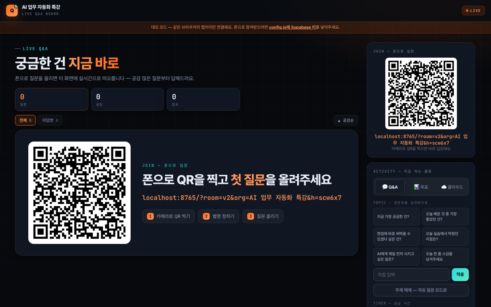
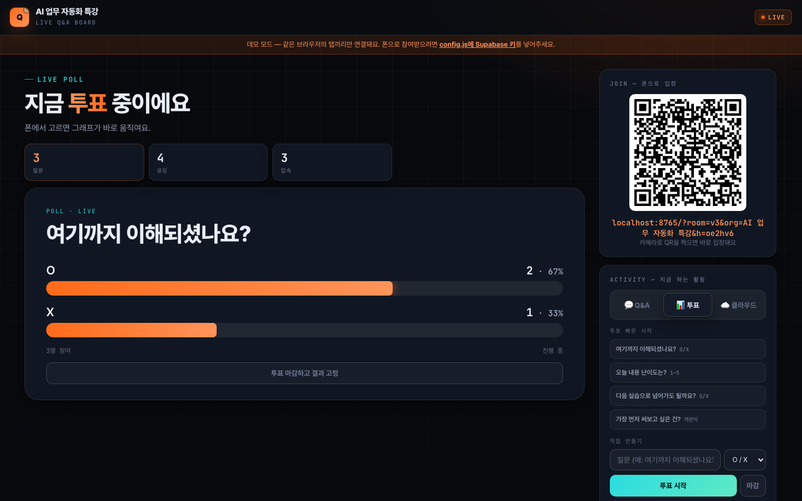
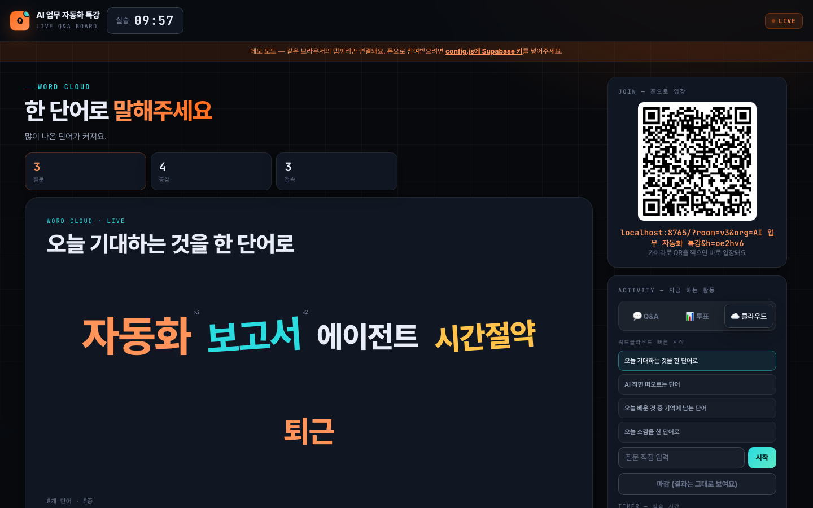
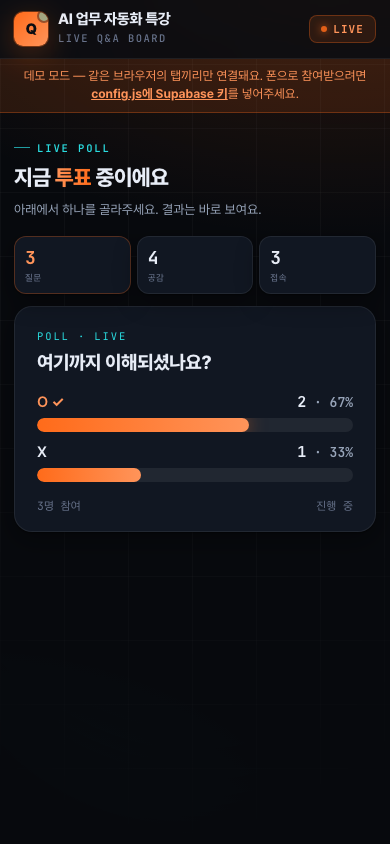
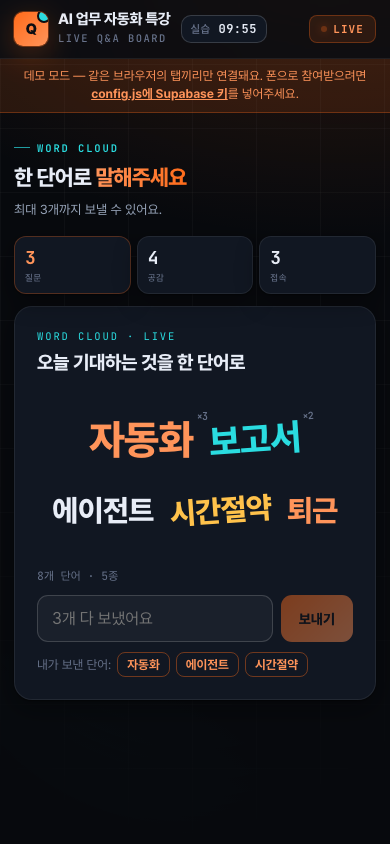
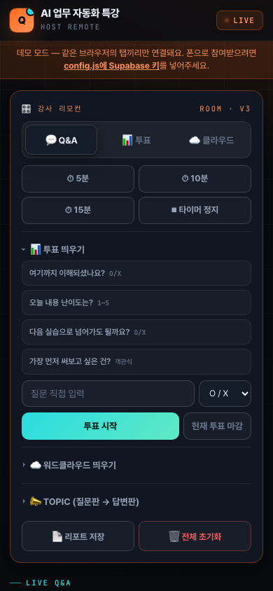

# LIVE Q&A 보드

강의·세미나·사내 교육 중에 **참가자가 폰으로 질문·투표·한 단어를 보내고, 강사는 공감 많은 질문부터 답하는** 실시간 보드예요.
서버 없이 HTML 파일 하나로 돌아가고, 코딩을 몰라도 설정 파일 한 곳만 고치면 바로 쓸 수 있어요.

**바로 써보기(데모 모드):** 강사 화면 https://jinnyjiinlee.github.io/live-qa-board/?screen · 참가자 화면 https://jinnyjiinlee.github.io/live-qa-board/ — 같은 브라우저에서 두 탭을 나란히 열어보세요

| 시작 화면 — 질문이 오기 전엔 QR이 크게 | 질문이 올라오면 공감 많은 순으로 |
|---|---|
|  |  |

| 투표 — 폰에서 고르면 그래프가 바로 움직여요 | 워드클라우드 — 많이 나온 단어가 커져요 |
|---|---|
|  |  |

| 참가자 — 질문 | 참가자 — 투표 | 참가자 — 워드클라우드 | 강사 리모컨 |
|---|---|---|---|
|  |  |  |  |

## 왜 만들었나요

기업 교육을 하다 보면 손 들고 질문하는 분이 거의 없어요. 궁금한 게 없어서가 아니라, 여러 사람 앞에서 "이거 왜 안 돼요?"라고 말하기가 어려워서요. 경영진과 신입이 같은 교육장에 있으면 더 그래요.
그래서 강의장 스크린에 QR을 띄워두고, 폰으로 별명만 정해서 질문을 올리게 했더니 질문이 훨씬 편하게 올라오더라구요.
다른 사람 질문에 "나도 궁금해"를 누르면 위로 올라오니까, 강사는 많은 분이 막힌 지점부터 풀어줄 수 있어요.

한화생명·경기도일자리재단 등 실제 교육 현장에서 쓰던 걸 누구나 쓸 수 있게 정리했어요.

## 무엇을 할 수 있나요

참가자 (폰)
- QR 찍고 별명만 정하면 입장 — 로그인·앱 설치 없음. 주사위를 누르면 별명을 지어줘요
- 질문 올리기 · 수정 · 삭제, "나도 궁금해" 공감, **익명으로 올리기** 토글
- 투표(O/X · 1~5 척도 · 객관식)에 참여하면 결과 그래프가 바로 보여요
- 워드클라우드에 단어 3개까지
- 👏🔥💡❤️😮 라이브 리액션 — 강사 화면 위로 날아가요
- 실습 타이머가 내 폰에도 보여요

강사 화면 (스크린)
- 질문 **핀 고정 · 답변 완료 · 삭제 · 강사 답변 메모**(카드에 표시되고 리포트에 남아요)
- **투표** 빠른 템플릿 4개 + 직접 만들기, 마감하면 결과 고정
- **워드클라우드** 빠른 템플릿 4개 + 직접 만들기
- **TOPIC 모드** — "오늘 가장 좋았던 건?" 같은 주제를 띄우면 질문판이 답변판으로
- **타이머** — 5/10/15분 또는 직접. 끝나면 소리·컨페티
- **승인 모드**(옵션) — 질문이 강사 승인 후에만 모두에게 보여요
- 효과음·배경음악 (음원 파일 없이 브라우저가 직접 만들어요 — 저작권 걱정 없음)
- **강의 리포트 저장** — 질문·강사 답변·투표 결과·워드클라우드·리액션을 HTML 한 장으로. 교육 담당자에게 그대로 보낼 수 있어요
- CSV 내려받기, 다크/라이트 테마, 방(room) 분리로 여러 강의 동시 진행

강사 리모컨 (강사 폰)
- 강사 화면의 REMOTE 카드에 있는 QR을 강사 폰으로 찍으면, **돌아다니면서** 핀·완료·답변 메모·투표 시작·타이머를 조작할 수 있어요
- 이 QR엔 리모컨 키가 들어 있으니 청중에겐 보여주지 마세요

브랜딩
- `config.js`에서 강조색(`accent`)과 로고(`logo`)를 바꾸면 버튼·그래프·TOP 카드가 전부 그 색으로 바뀌어요. 교육회사·기관 브랜드로 쓸 수 있어요

## 1단계: 일단 열어보기 (설치 없음)

1. 이 저장소를 내려받아요. 초록색 **Code → Download ZIP**, 압축 풀기
2. `index.html`을 더블클릭해서 브라우저로 열어요
3. 주소 끝에 `?screen`을 붙이면 강사 화면, 안 붙이면 참가자 화면이에요

이 상태는 **데모 모드**예요. 같은 컴퓨터·같은 브라우저의 탭끼리만 연결돼요.
탭을 여러 개 열어서 강사 화면과 참가자 화면이 어떻게 움직이는지 미리 볼 수 있어요.

## 2단계: 내 강의에 맞게 바꾸기

`config.js`를 메모장이나 아무 편집기로 열어서 고치면 돼요.

```js
title: '우리 강의',        // 화면 상단과 입장 화면에 보이는 이름
accent: '#FF6B1A',        // 강조색 — 교육회사 색으로
logo: '',                 // 로고 파일 이름 (같은 폴더에 두세요)
theme: 'dark',            // 'dark' 또는 'light'
moderation: false,        // true면 질문이 강사 승인 후에 보여요
allowAnonymous: true,     // 익명 올리기 토글 허용
topicPresets: [ ... ],    // TOPIC 버튼
pollPresets: [ ... ],     // 투표 빠른 템플릿
cloudPresets: [ ... ],    // 워드클라우드 빠른 템플릿
```

파일을 안 고치고 주소 뒤에 붙여서 바꿀 수도 있어요.

- `?org=AI 업무 자동화 특강` — 이름 바꾸기
- `?theme=light` — 라이트 테마
- `?room=b반` — 방 분리 (강사는 `?screen&room=b반`)

## 3단계: 실시간 연결 (Supabase, 5분)

참가자들이 **각자 폰으로** 참여하려면 탭끼리 연결이 아니라 인터넷을 거쳐야 해요.
그 통로로 [Supabase](https://supabase.com)의 무료 플랜을 써요. 데이터베이스 표를 만들 필요 없이 "실시간 방송" 기능만 빌려 쓰는 거라 설정이 거의 없어요.

1. [supabase.com](https://supabase.com)에 가입하고 **New project**를 눌러요. 이름은 아무거나, 비밀번호는 만들어두기만 하면 돼요 (여기서 다시 쓸 일 없어요)
2. 프로젝트가 만들어지면 왼쪽 메뉴 **Project Settings → API**로 가요
3. **Project URL**과 **anon public** 키 두 개를 복사해요
4. `config.js`에 붙여넣어요

```js
supabaseUrl: 'https://xxxxxxxx.supabase.co',
supabaseAnonKey: 'eyJhbGciOi...',
```

> anon 키는 브라우저에 공개되도록 만들어진 키라 파일에 적어도 괜찮아요.
> 바로 아래에 있는 **service_role** 키는 절대 넣지 마세요.

저장하고 다시 열면 상단의 "데모 모드" 띠가 사라지고, 다른 기기에서도 같이 보여요.

## 4단계: 인터넷에 올리기 (Netlify Drop, 1분)

참가자 폰이 접속하려면 파일이 인터넷에 있어야 해요. 제일 쉬운 방법은 [Netlify Drop](https://app.netlify.com/drop)이에요.

1. 위 링크를 열고 (무료 가입)
2. `index.html`과 `config.js`가 들어 있는 **폴더째로** 끌어다 놓아요
3. 주소가 하나 나와요 (예: `https://xxx.netlify.app`). 끝!

강의장에서는 `https://xxx.netlify.app/?screen`을 스크린에 띄우고, 참가자는 화면의 QR을 찍으면 돼요.

GitHub Pages, Vercel, Cloudflare Pages 등 정적 사이트가 올라가는 곳이면 어디든 돼요.

## 강의장에서 쓰는 법

| 키 | 동작 |
|---|---|
| `F` | 전체화면 |
| `Q` | QR 크게 띄우기 / 닫기 |
| `S` | 공감순 ↔ 최신순 |

- 시작할 때 `Q`로 QR을 크게 띄우고 입장을 받아요. 첫 활동으로 워드클라우드 "오늘 기대하는 것을 한 단어로"를 띄우면 분위기가 빨리 풀려요
- 설명 한 덩어리가 끝나면 투표 "여기까지 이해되셨나요?"(O/X)로 확인하고 넘어가요
- 실습 시작할 때 타이머 10분을 걸어두면 폰에도 같이 보여요
- 쉬는 시간 전에 TOPIC을 "오전에 가장 좋았던 건?"으로 바꾸면 소감이 모여요
- 질문에 답하면서 **답변 메모**를 짧게 남겨두면, 끝나고 **강의 리포트 저장** 한 번으로 Q&A 기록이 완성돼요
- 질문·투표 기록은 강사 화면(브라우저)에 저장돼요. 탭을 닫아도 다시 열면 남아 있지만, 다른 컴퓨터로 옮기면 안 보여요. 새 강의를 시작할 땐 **전체 초기화**를 눌러주세요

## 알아두기 (보안)

- 참가자 화면이 보낸 값(별명·질문·단어·아바타)은 강사 화면이 받을 때 길이와 허용 목록을 확인하고, 화면에 그릴 때 HTML로 해석하지 않아요
- 강사 권한(핀·완료·삭제·초기화·투표 시작)은 강사 화면과, 리모컨 키를 가진 강사 폰에서만 동작해요. 참가자가 그 신호를 흉내 내 보내도 무시돼요
- 질문 작성자 ID는 참가자들에게 해시로만 전달되고, 공감·투표는 숫자만 전달돼요. 누가 눌렀는지는 강사 화면 밖으로 나가지 않아요
- 강사 화면이 띄우는 QR 주소에는 그 세션만의 토큰(`h=…`)이 붙고, 참가자 화면은 그 토큰이 붙은 상태만 받아요
- 다만 QR을 찍은 사람(=같은 강의장에 있는 사람)이 작정하면 강사 화면을 흉내 낼 수는 있어요. 로그인·서버 없이 익명 참여를 우선한 설계라 그래요. 외부 불특정 다수가 아니라 강의실 안에서 쓰는 도구로 생각해주세요

## 구조

- `index.html` — 화면·동작 전부 (한 파일)
- `config.js` — 설정 (여기만 고치면 됨)
- 외부 라이브러리: supabase-js (실시간), qrcode-generator (QR을 브라우저에서 직접 그림 — 외부 QR 서버로 주소를 보내지 않아요). 둘 다 무결성 해시(SRI)로 고정돼 있어요

질문 데이터는 Supabase 데이터베이스에 저장되지 않아요. Realtime 채널로 흘려보내고, 강사 화면 브라우저에만 남아요.

## 라이선스

MIT — 마음껏 가져다 쓰고 고쳐 쓰세요. 만든 사람: [이지인 · DayFocusLab](https://www.dayfocuslab.com)
