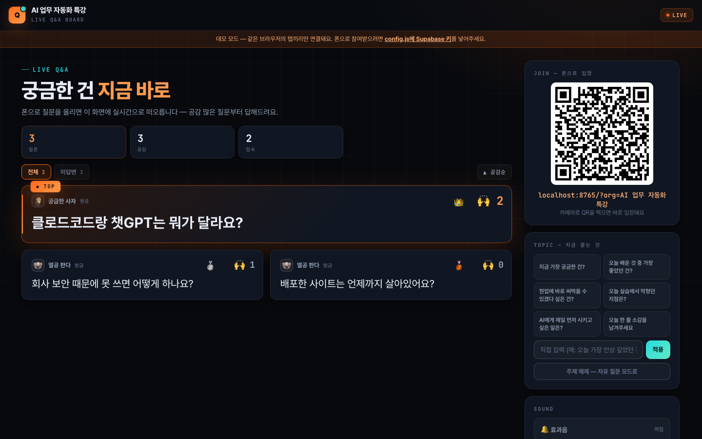
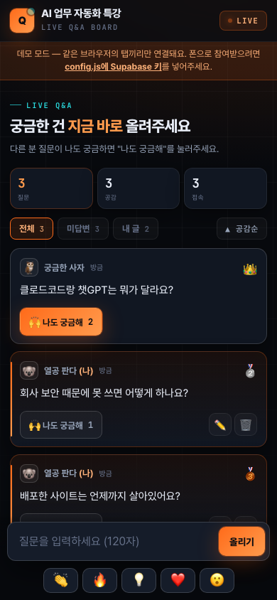
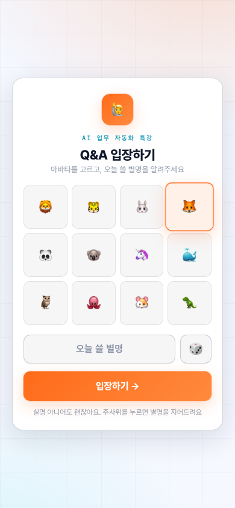

# LIVE Q&A 보드

강의·세미나·사내 교육 중에 **참가자가 폰으로 질문을 올리고, 공감 많은 질문부터 강사가 답하는** 실시간 보드예요.
서버 없이 HTML 파일 하나로 돌아가고, 코딩을 몰라도 설정 파일 한 곳만 고치면 바로 쓸 수 있어요.

**바로 써보기(데모 모드):** 강사 화면 https://jinnyjiinlee.github.io/live-qa-board/?screen · 참가자 화면 https://jinnyjiinlee.github.io/live-qa-board/ — 같은 브라우저에서 두 탭을 나란히 열어보세요



| 참가자 (폰) | 입장 화면 (라이트 테마) |
|---|---|
|  |  |

## 왜 만들었나요

기업 교육을 하다 보면 손 들고 질문하는 분이 거의 없어요. 궁금한 게 없어서가 아니라, 여러 사람 앞에서 "이거 왜 안 돼요?"라고 말하기가 어려워서요.
그래서 강의장 스크린에 QR을 띄워두고, 폰으로 익명 별명으로 질문을 올리게 했더니 질문이 훨씬 편하게 올라오더라구요.
다른 사람 질문에 "나도 궁금해"를 누르면 위로 올라오니까, 강사는 많은 분이 막힌 지점부터 풀어줄 수 있어요.

한화생명·경기도일자리재단 등 실제 교육 현장에서 쓰던 걸 누구나 쓸 수 있게 정리했어요.

## 기능

- 폰으로 QR 찍고 별명만 정하면 입장 (로그인·앱 설치 없음)
- 질문 올리기 · 수정 · 삭제, "나도 궁금해" 공감, 공감순/최신순 정렬
- 강사 화면: 핀 고정 · 답변 완료 처리 · 답변완료 숨기기 · 전체 초기화
- TOPIC 모드: 강사가 "오늘 가장 좋았던 건?" 같은 주제를 띄우면 질문판이 답변판으로 바뀜
- 👏🔥💡❤️😮 라이브 리액션 (화면 위로 날아감)
- 효과음·배경음악 (음원 파일 없이 브라우저가 직접 생성 — 저작권 걱정 없음)
- CSV 내려받기 (질문·공감·시각·상태)
- 다크/라이트 테마, 방(room) 분리로 여러 강의 동시 진행

## 1단계: 일단 열어보기 (설치 없음)

1. 이 저장소를 내려받아요. 초록색 **Code → Download ZIP**, 압축 풀기
2. `index.html`을 더블클릭해서 브라우저로 열어요
3. 주소 끝에 `?screen`을 붙이면 강사 화면, 안 붙이면 참가자 화면이에요

이 상태는 **데모 모드**예요. 같은 컴퓨터·같은 브라우저의 탭끼리만 연결돼요.
탭을 여러 개 열어서 강사 화면과 참가자 화면이 어떻게 움직이는지 미리 볼 수 있어요.

## 2단계: 내 강의에 맞게 바꾸기

`config.js`를 메모장이나 아무 편집기로 열어서 고치면 돼요.

```js
title: '우리 강의',        // 화면 상단과 입장 화면에 보이는 이름
theme: 'dark',            // 'dark' 또는 'light'
defaultRoom: 'main',      // 방 이름
topicPresets: [ ... ],    // 강사 화면 TOPIC 버튼에 뜨는 질문들
avatars: [ ... ],         // 참가자가 고르는 아바타
```

파일을 안 고치고 주소 뒤에 붙여서 바꿀 수도 있어요.

- `?org=AI 업무 자동화 특강` — 이름 바꾸기
- `?theme=light` — 라이트 테마
- `?room=b반` — 방 분리 (강사는 `?screen&room=b반`)

## 3단계: 실시간 연결 (Supabase, 5분)

참가자들이 **각자 폰으로** 참여하려면 탭끼리 연결이 아니라 인터넷을 거쳐야 해요.
그 통로로 [Supabase](https://supabase.com)의 무료 플랜을 써요. 데이터베이스 표를 만들 필요 없이 "실시간 방송" 기능만 빌려 쓰는 거라 설정이 거의 없어요.

1. [supabase.com](https://supabase.com)에 가입하고 **New project**를 눌러요. 이름은 아무거나, 비밀번호는 만들어두기만 하면 돼요 (여기서 다시 쓸 일 없어요)
2. 프로젝트가 만들어지면 왼쪽 메뉴 **Project Settings → API**로 가요
3. **Project URL**과 **anon public** 키 두 개를 복사해요
4. `config.js`에 붙여넣어요

```js
supabaseUrl: 'https://xxxxxxxx.supabase.co',
supabaseAnonKey: 'eyJhbGciOi...',
```

> anon 키는 브라우저에 공개되도록 만들어진 키라 파일에 적어도 괜찮아요.
> 바로 아래에 있는 **service_role** 키는 절대 넣지 마세요.

저장하고 다시 열면 상단의 "데모 모드" 띠가 사라지고, 다른 기기에서도 같이 보여요.

## 4단계: 인터넷에 올리기 (Netlify Drop, 1분)

참가자 폰이 접속하려면 파일이 인터넷에 있어야 해요. 제일 쉬운 방법은 [Netlify Drop](https://app.netlify.com/drop)이에요.

1. 위 링크를 열고 (무료 가입)
2. `index.html`과 `config.js`가 들어 있는 **폴더째로** 끌어다 놓아요
3. 주소가 하나 나와요 (예: `https://xxx.netlify.app`). 끝!

강의장에서는 `https://xxx.netlify.app/?screen`을 스크린에 띄우고, 참가자는 화면의 QR을 찍으면 돼요.
사이트 이름은 Netlify 설정에서 원하는 이름으로 바꿀 수 있어요.

GitHub Pages, Vercel, Cloudflare Pages 등 정적 사이트가 올라가는 곳이면 어디든 돼요.

## 강의장에서 쓰는 법

| 키 | 동작 |
|---|---|
| `F` | 전체화면 |
| `Q` | QR 크게 띄우기 / 닫기 |
| `S` | 공감순 ↔ 최신순 |

- 시작할 때 `Q`로 QR을 크게 띄우고 입장을 받아요
- 쉬는 시간 전에 TOPIC을 "오전에 가장 좋았던 건?"으로 바꾸면 소감이 모여요
- 끝나고 **CSV로 내려받기**를 누르면 질문 전체가 저장돼요. 다음 강의 FAQ 만들 때 좋아요
- 질문은 강사 화면(브라우저)에 저장돼요. 강사 화면 탭을 닫아도 다시 열면 남아 있지만, 다른 컴퓨터로 옮기면 안 보여요. 새 강의를 시작할 땐 **전체 초기화**를 눌러주세요

## 알아두기 (보안)

- 참가자 화면이 보낸 값(별명·질문·아바타)은 강사 화면이 받을 때 길이와 허용 목록을 확인하고, 화면에 그릴 때 HTML로 해석하지 않아요
- 강사 권한(핀·완료·삭제·초기화)은 강사 화면에서만 동작해요. 참가자가 그 신호를 흉내 내 보내도 무시돼요
- 질문 작성자 ID는 참가자들에게 해시로만 전달돼서, 남의 질문을 수정·삭제하려면 그 사람 기기에 있는 원본 ID가 필요해요
- 참가자 화면은 처음 확인한 강사 화면(`?screen`)이 보낸 상태만 받아요. 강사 화면은 참가자보다 먼저 열어두세요
- 다만 익명 참여가 목적이라 로그인이 없고, 방 이름(`room`)을 아는 사람은 누구나 들어올 수 있어요. 외부에 공개된 자리면 방 이름을 짐작하기 어렵게 지어주세요. 공감 수는 참고용이지 투표용으로 쓰기엔 약해요

## 구조

- `index.html` — 화면·동작 전부 (한 파일)
- `config.js` — 설정 (여기만 고치면 됨)
- 외부 라이브러리: supabase-js (실시간), qrcode-generator (QR을 브라우저에서 직접 그림 — 외부 QR 서버로 주소를 보내지 않아요)

질문 데이터는 Supabase 데이터베이스에 저장되지 않아요. Realtime 채널로 흘려보내고, 강사 화면 브라우저에만 남아요.

## 라이선스

MIT — 마음껏 가져다 쓰고 고쳐 쓰세요. 만든 사람: [이지인 · DayFocusLab](https://www.dayfocuslab.com)
